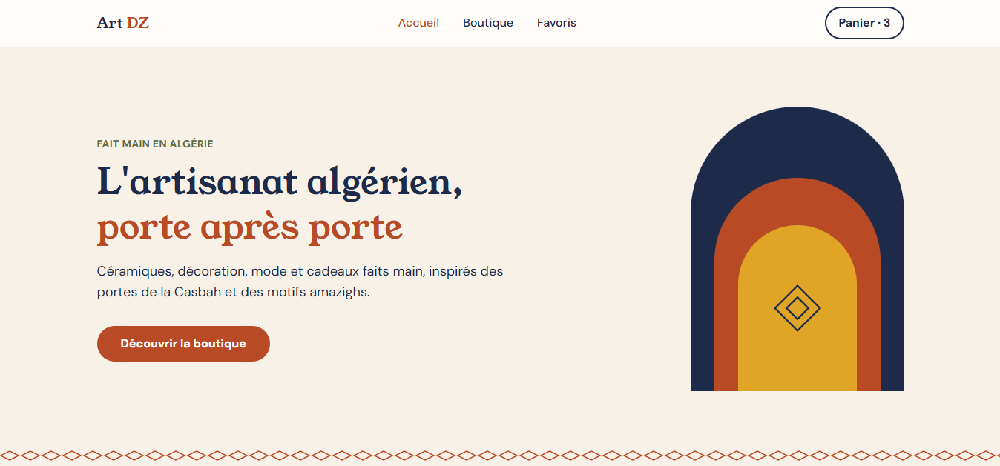
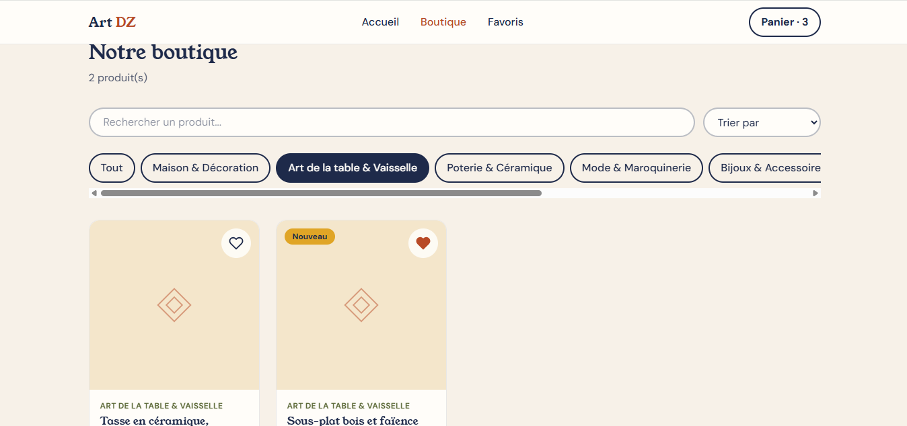
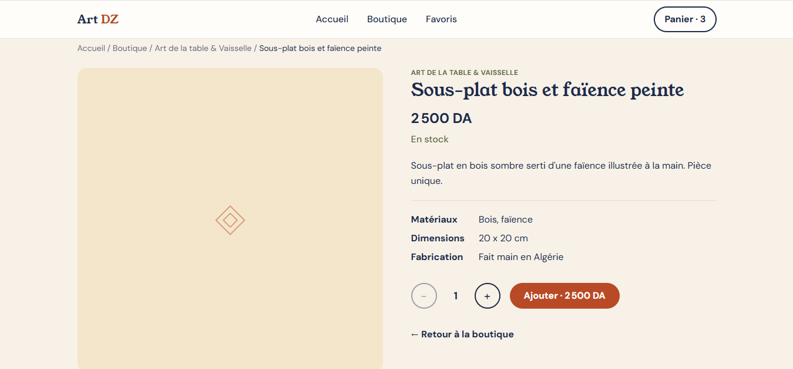
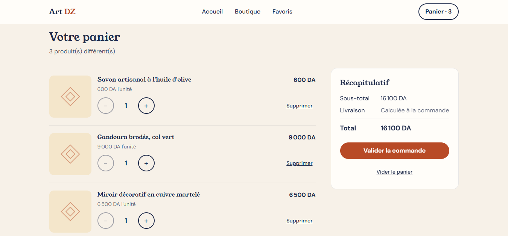
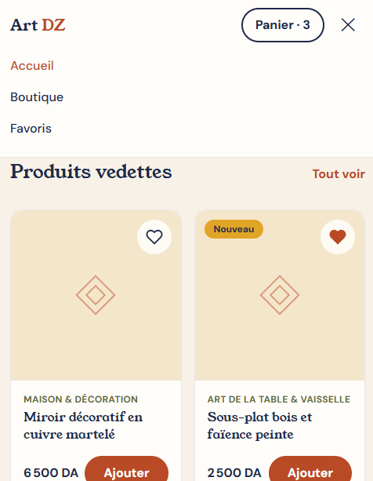
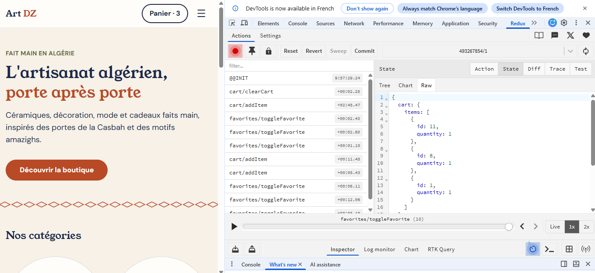

# Art Dz

**Lien en ligne :** [https://art-dz.vercel.app]

## Description

Boutique en ligne de produits artisanaux algériens (décoration, poterie,
mode, bijoux, cosmétiques naturels, cadeaux). Le visiteur peut parcourir
le catalogue, filtrer et rechercher des produits, consulter leur fiche,
gérer un panier et enregistrer des favoris. Le projet se concentre sur
React et Redux : il n'y a pas de backend, de base de données ni de paiement.

## Captures d'écran

| Accueil | Boutique |
|---|---|
|  |  |

| Détail produit | Panier |
|---|---|
|  |  |

| Mobile | Redux DevTools |
|---|---|
|  |  |

## Technologies utilisées

- React 19 et JSX
- Vite (outil de build)
- Redux Toolkit et React-Redux (état global)
- React Router (navigation)
- Tailwind CSS (style et responsive)
- JavaScript (ES6+)
- Git / GitHub, VS Code, Redux DevTools

## Principaux composants React

| Composant | Rôle |
|---|---|
| `Layout` | cadre commun (header, footer, zone de page) |
| `Header`, `Footer` | navigation et pied de page |
| `ProductCard` | carte d'un produit |
| `ProductGrid` | grille de cartes, avec état vide |
| `ProductGallery` | galerie de photos d'un produit |
| `QuantitySelector` | choix de la quantité (composant contrôlé) |
| `CategoryFilter` | boutons de filtre par catégorie |
| `CartItem` | ligne du panier |
| `FavoriteButton` | bouton cœur |
| `Button`, `Container`, `SectionTitle`, `PatternDivider` | composants de base réutilisables |

Pages : `Home`, `Shop`, `ProductDetail`, `Cart`, `Favorites`, `NotFound`.

## État Redux

Le store contient deux slices :

```js
{
  cart:      { items: [ { id, quantity } ] },
  favorites: { ids: [ id ] }
}
```

- **`cartSlice`** : actions `addItem`, `removeItem`, `setQuantity`,
  `clearCart`. Selectors : `selectCartItems`, `selectCartCount`,
  `selectCartTotal`.
- **`favoritesSlice`** : action `toggleFavorite`. Selector : `selectFavoriteIds`.
- Le panier stocke seulement l'identifiant et la quantité. Les informations
  du produit (nom, prix, photo) sont retrouvées dans `src/data/products.js`.
- Le store est sauvegardé dans le `localStorage` à chaque changement, et
  les données relues sont validées au chargement.

## Fonctionnalités implémentées

- Catalogue de produits avec fiche détaillée (galerie, prix en DA, matériaux, dimensions)
- Ajout, suppression et modification de quantité dans le panier
- Total du panier et badge du nombre d'articles, mis à jour en temps réel
- Recherche (sans tenir compte des accents), filtre par catégorie, tri par prix et nouveautés
- Favoris avec page dédiée
- Sauvegarde du panier et des favoris (localStorage)
- Produits similaires, chemin de navigation (breadcrumb), pages d'erreur
- Design responsive (mobile, tablette, ordinateur) et navigation au clavier

## Lancer le projet

```bash
git clone https://github.com/Yas-Tech-tc/art-dz.git
cd art-dz
npm install
npm run dev
```

Puis ouvrir http://localhost:5173.

Autres commandes : `npm run build` (version de production),
`npm run preview` (tester le build), `npm run lint` (vérifier le code).

## Licence

Tous droits réservés. Code fourni uniquement pour évaluation académique.